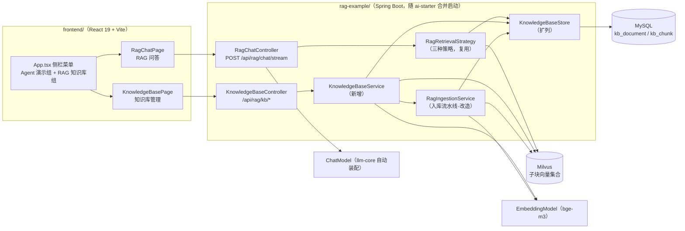
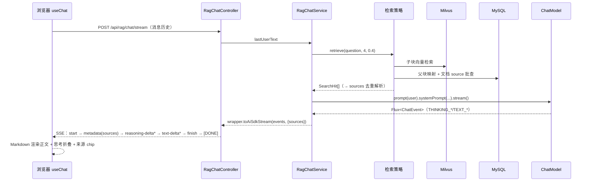
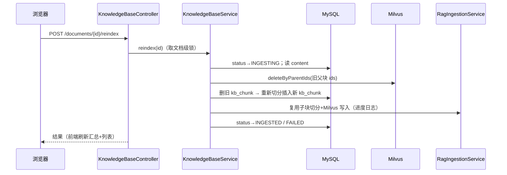

# RAG 模块设计：RAG 问答 + 知识库管理（前端新增模块 & 入库切分逻辑改造）

> 状态：已实施（2026-09-22，后端 `mvn clean install -DskipTests` 与前端 `npm run build` 均通过）
> 涉及模块：`frontend/`（React 19 + Vite 统一前端）、`rag-example/`（RAG 后端）
> 关联约定：见根目录 `AGENTS.md`（依赖注入约定、RAG 懒装配、.env 登记约定、验证标准）

---

## 1. 背景与目标

`rag-example` 已具备完整的父子分段 RAG 后端能力（文档加载 → 父块存 MySQL → 子块向量化存 Milvus → 子块检索映射父块 → LLM 问答），并通过 `/rag/*` REST 接口暴露；但存在两类问题：

1. **无 Web 界面**：统一前端 `frontend/` 目前只有 Agent 演示页（流式对话、出行规划），RAG 能力无法在页面上使用。
2. **入库粒度错误**：Markdown 文档在入 `kb_document` 表时被拆成了多条记录（本地 `MarkdownLoader` 按标题章节切分后，`RagIngestionService` 把每个章节当作独立文档落库），与"一个文件 = 一条文档记录"的预期不符；`kb_chunk` 也缺少子标题路径信息，无法支撑"文档块预览"按标题展示。

本设计覆盖以下需求：

| # | 需求 | 落点 |
|---|------|------|
| 1 | 前端新增 RAG 模块菜单，展开含「RAG 问答」「知识库管理」二级菜单 | `frontend/src/App.tsx` |
| 2 | RAG 问答：交互界面，回答含思考内容 + 正文（Markdown 渲染），回答下方展示检索命中的文档来源（文件名 label，不跳转） | 新页面 + 新流式接口 |
| 3 | 知识库管理：汇总信息（文档数/块数/总字符/向量维度）+ 文档列表（搜索/排序/分页）+ 文档块预览/重建索引/删除/新增文档 | 新页面 + 管理接口 |
| 4 | 入库改造：`kb_document` 与文件一对一；按「标题切分 + 父块 token 粒度切分」存 `kb_chunk`（新增 `title` 子标题路径字段；父块 token 数沿用现有默认 1000，需求中"500"为示例值）；`kb_document.title` 取一级标题，缺省取文件名（不含后缀） | `rag-example` 入库流水线改造 |

非目标（明确不做）：
- 权限/多租户/多知识库隔离（单库单集合，示例级）；
- 上传入库的异步任务与进度推送（同步等待，见 §9 取舍）；
- RAG 问答的多轮会话记忆（每问独立检索，见 §6.2）。

---

## 2. 现状分析

### 2.1 后端现状（rag-example）

| 组件 | 现状 | 与需求的差距 |
|------|------|--------------|
| `loader/MarkdownLoader.java` | 本地 fork 的上下文继承章节切分：标题开启辖区、空父级标题不成块、块内容带 `"### 路径 / 子路径\n正文"` 前缀，metadata 携带 `title` / `title_path` / `category` / `type` | 切分结果被当作"多个文档"使用；`title_path` 元数据未落库 |
| `service/RagIngestionService.java` | `loadFile()` → `loader.load()` 返回 `List<Document>` → `ingest(List<Document>)` 逐个文档执行父子分段流水线落库 | **一个 md 文件产出 N 个 `kb_document` 行**（每个章节一条）；无删除/重建逻辑 |
| `storage/KnowledgeBaseStore.java` | 懒建表（`CREATE TABLE IF NOT EXISTS`）+ 文档/父块事务落库 + 状态推进（INGESTING/INGESTED/FAILED） | 表结构无 `kb_document.content`、`kb_chunk.title`；无统计/分页/删除/按文档删 Milvus 子块能力 |
| `entity/KbDocument` / `KbChunk` | `kb_document`：id/title/source/content_type/content_chars/chunk_count/status/created_at/updated_at；`kb_chunk`：id/document_id/chunk_index/content/char_count/child_count/created_at | 缺 `doc_type`（文档格式）、`content`（原始全文，重建索引用）、`title`（子标题路径） |
| `service/RagSearchService.java` | 同步问答：策略检索 → 提示词组装（系统提示词"智能客服" + SnEL 用户模版）→ `chatModel.prompt().call().getContent()` | 同步返回 String：无流式、无思考内容、无来源返回 |
| `retrieval/*` | 策略接口 + 三实现（parent-child / mysql-fulltext / hybrid-rrf），`SearchHit` 携带 `documentId` 与命中子块 metadata | 可直接复用；来源解析需补"documentId → 文档 source"映射 |
| `repository/MilvusChildRepository.java` | 自建集合（id/parent_id/embedding/content/metadata），`parent_id` 独立字段 + TRIE 索引；支持 save/search/deleteById | 缺"按 parent_id 过滤删除"（删除/重建索引必需）、缺向量维度读取 |
| `controller/RagController.java` | `/rag/ingest/text|file|directory`、`/rag/search`、`/rag/ask` | 无 `/api` 前缀（前端 vite 代理只转发 `/api`）；无管理类接口 |
| 分块配置 | `RAG_PARENT_CHUNK_SIZE` 默认 1000 token | 无需变更（沿用父块 1000 / 子块 200；需求中"500 token"为示例值） |

> 关键事实：`EmbeddingModel.dimensions()` 的实现是 `embed("test").length`（solon-ai-core），**每次调用都会发起一次真实嵌入请求**，不缓存——汇总接口的"向量维度"需做缓存或优先从 Milvus 集合 schema 读取。
> 关键事实：solon-ai 4.1.0 `ChatModel.prompt(msg).systemPrompt(...).stream()` 返回 `Flux<ChatEvent>`（事件模型：THINKING_START/DELTA/END、TEXT_START/DELTA/END…），`solon-ai-ui-aisdk` 的 `AiSdkStreamWrapper.toAiSdkStream(Flux<ChatEvent>, metadata)` 可将其包装为 Vercel AI SDK UI Message Stream Protocol v1 SSE，**思考事件自动映射为 reasoning part**；`metadata` 参数在 start part 之后发送，可用于携带来源列表。

### 2.2 前端现状（frontend/）

- React 19 + Vite 6 + Tailwind v4 + `@ai-sdk/react`（useChat）+ Streamdown（`MessageResponse` Markdown 渲染）+ AI Elements 组件（`message/reasoning/shimmer` 等）+ shadcn 风格 `components/ui/*`（button/input/select/dialog/dropdown-menu/badge/spinner/textarea 等，**无 checkbox、无 table、无分页组件**）。
- `App.tsx`：hash 路由（`#/chat`、`#/travel`）+ 左侧菜单，菜单为**平铺结构**（`PAGES` 数组），需要改造为可分组。
- `ChatDemoPage.tsx`：完整的 useChat 流式对话实现（DefaultChatTransport POST SSE、MessageBubble 渲染 text/reasoning part、停止/重发），RAG 问答页可直接复用该骨架。
- vite dev 将 `/api` 代理到 `http://localhost:8080`（ai-starter 合并端口）——**新增后端接口必须挂在 `/api` 前缀下**。

### 2.3 差距汇总

```
数据层   ：kb_document 与文件 1:N（应为 1:1）；缺 content/doc_type/title 字段；无迁移机制
入库层   ：loader 输出被当作文档；无「标题切分 + 父块 token 切分」的落库语义；无删除/重建
接口层   ：无 /api 前缀管理接口；问答无流式/思考/来源；无汇总、分页、上传/粘贴入口
Milvus层 ：无按 parent_id 批量删除；无向量维度读取
前端层   ：无 RAG 菜单与两个页面；菜单不支持分组
```

---

## 3. 总体设计

### 3.1 架构与数据流



### 3.2 菜单与路由

`App.tsx` 的 `PAGES` 平铺数组改造为**分组结构**，hash 路由新增两个键：

```
侧栏菜单
├── Agent 演示
│   ├── 流式对话          #/chat       （现有）
│   └── 出行规划工作台     #/travel     （现有）
└── RAG 知识库
    ├── RAG 问答          #/rag/chat   （新增 RagChatPage）
    └── 知识库管理        #/rag/kb     （新增 KnowledgeBasePage）
```

实现要点：`PageKey` 扩展为 `'chat' | 'travel' | 'ragChat' | 'ragKb'`；`pageFromHash()` 按 hash 精确匹配；侧栏渲染两级（组标题 + 子项），样式沿用 `.nav-item` 体系（新增 `.nav-group` 组标题样式）。

---

## 4. 数据模型改造

### 4.1 表结构变更（DDL Diff）

```sql
-- kb_document：与文件一对一，新增 2 列
ALTER TABLE kb_document
  ADD COLUMN content  MEDIUMTEXT  NULL COMMENT '原始全文（重建索引依据；粘贴入库也存此列）',
  ADD COLUMN doc_type VARCHAR(16)  NULL COMMENT '文档格式：markdown/html/text';

-- kb_chunk：新增子标题路径
ALTER TABLE kb_chunk
  ADD COLUMN title VARCHAR(512) NULL COMMENT '子标题路径（如：配置提供步骤(面向产品) / 5.提供记账规则配置）';
```

变更后语义：

| 表.列 | 语义（改造后） |
|-------|----------------|
| `kb_document.id` | 文档唯一标识（UUID hex），**一个文件/一次粘贴 = 一行** |
| `kb_document.title` | 文档标题。取值规则（§5.2）：优先文档内一级标题 → 文件名（不含后缀）→ 兜底 |
| `kb_document.source` | 来源：服务器文件绝对路径 / 上传文件的原始文件名 / URL；**粘贴入库为 NULL** |
| `kb_document.content_type` | 来源类型 `text/file/url`（既有语义不变，页面不直接展示） |
| `kb_document.doc_type` | **文档格式**，仅三种枚举 `markdown/html/text`（页面"文档类型"列）。映射：`.md`/`.markdown`→markdown、`.txt`→text、`.html`/`.htm`→html，粘贴按所选格式；doc/pdf 等格式暂不考虑 |
| `kb_document.content` | 原始全文（MEDIUMTEXT，≤16MB）。**不重复存切分内容**；是"重建索引"的切分依据 |
| `kb_document.content_chars` | 原始全文字符数（= `LENGTH(content)` 字符口径） |
| `kb_document.chunk_count` | 父块数量（= 该文档 `kb_chunk` 行数） |
| `kb_document.status` | INGESTING / INGESTED / FAILED（沿用；重建索引期间复用 INGESTING） |
| `kb_chunk.id` | 父块 UUID（同时作为 Milvus 子块 `parent_id`） |
| `kb_chunk.document_id` | 所属文档 id |
| `kb_chunk.chunk_index` | 父块在**文档内**的序号（0 起连续递增，跨章节不断号） |
| `kb_chunk.title` | **子标题路径**：该父块所属章节的完整标题路径（`" / "` 连接），来自 `MarkdownLoader` 的 `title_path`；txt/html 或无标题文档为 NULL |
| `kb_chunk.content` | 父块内容（保留 `"### 路径\n正文"` 标题前缀，利于向量检索语义完整性） |
| `kb_chunk.char_count` | 父块字符数 |

同步动作（约定：DDL 改动必须三处一致）：
1. `KnowledgeBaseStore` 内 `DDL_DOCUMENT` / `DDL_CHUNK` 常量补充上述列（覆盖新建库）；
2. `rag-example/src/main/resources/sql/knowledge_base.sql` 同步（手工初始化/查阅用）;
3. 实体 `KbDocument` / `KbChunk` 补充字段。

### 4.2 存量库处理（人工清理）

存量知识库为演示数据，**不做自动迁移、回填与合并**，人工清理后即进入新结构：

1. **新建库无需处理**：`KnowledgeBaseStore` 懒建表 DDL（§4.1 变更后）在首次使用知识库时自动创建新结构；
2. **已有旧表的库**，人工二选一：
   - 推荐：`DROP TABLE kb_chunk, kb_document;`（旧全文索引随表删除），应用首次使用知识库时按新 DDL 懒建；
   - 保留表结构：手工执行 §4.1 的两条 `ALTER TABLE ... ADD COLUMN`，旧数据仅补空列（`content`/`doc_type`/`title` 为 NULL）；
3. 历史上一个 md 文件产生的多条 `kb_document` 记录随清理删除；若选方案 2 保留旧行，`content` 为 NULL 的文档执行"重建索引"时会提示缺少原始内容（§6.1），删除后重新上传即可。

---

## 5. 入库流水线改造（核心）

### 5.1 新流水线：SourceDocument → Section → Parent Chunk → Child Chunk

现状问题：`loadFile()` 返回 `loader.load()` 的 `List<Document>`（md = N 个章节 Document），`ingest()` 把每个元素当独立文档 → 一文件多记录。

改造引入两个中间概念，把"文件"与"切分产物"明确分层：

```
文件 / 粘贴内容
   │  ① 装配 SourceDocument（一对一）
   ▼
SourceDocument { rawText 原始全文, title 解析标题, source 来源, contentType 来源类型, docType 文档格式 }
   │  ② 章节切分 sectionize（复用 MarkdownLoader 上下文继承算法，仅 md）
   ▼
Section[] { titlePath 子标题路径, content 章节正文（带 "### 路径" 前缀） }
   │  ③ 父块切分（TokenSizeTextSplitter，沿用默认 1000 token，逐章节）
   ▼
ParentChunk[] { chunk_index 全文连续, title = 所属章节 titlePath, content, charCount }
   │  ④ MySQL 落库（kb_document 1 行 + kb_chunk N 行，同一事务，status=INGESTING）
   │  ⑤ 子块切分（childSplitter 200 token）→ 批量 embedding → Milvus Upsert（parent_id 独立字段，进度回调）
   ▼
status → INGESTED / FAILED（语义不变）
```

关键实现决策：

1. **`MarkdownLoader` 不改算法，改用法**：其 `load()` 返回的每个 `Document` 重定义为"章节（Section）"而非"文档"。`RagIngestionService` 内部新增 `sectionize(rawText, docType)`：
   - `markdown`：`new MarkdownLoader(rawText.getBytes(UTF_8)).load()` → 每个返回 Document 即一个 Section（content 已带 `"### 路径\n正文"` 前缀，metadata `title_path` 即章节路径）；
   - `text`：单 Section，`titlePath = null`，content = 原文；
   - `html`：`HtmlSimpleLoader` 转出的纯文本作为单 Section（`titlePath = null`）。
2. **父块逐章节切分**：每章节用 `parentSplitter`（沿用默认 1000 token）独立切分，避免跨章节合并正文；`chunk_index` 在**文档内全局连续编号**。父块 metadata 继承章节 Document 的 metadata（source/filename/title/title_path），子块在其上追加 `document_id / parent_id / child_index`（现契约不变）。
3. **`kb_chunk.title` 取值**：所属章节的 `title_path`（原样，`" / "` 连接，不带 `###`）。示例：`配置提供步骤(面向产品) / 5.提供记账规则配置`。markdown 无标题文档章节路径为 `Root`（MarkdownLoader 既有默认），text/html 为 NULL——预览卡片对 NULL 显示 `—`。
4. **落库**：`buildDocumentRow()` 增加 `content = rawText`、`docType`；`createDocumentWithChunks()` 签名不变，`KbChunk` 行填充 `title`。
5. **并行入库不变**：任务粒度从"一个章节 Document"变为"一个 SourceDocument"（天然更粗），`ragIngestExecutor`、进度回调、失败语义（按提交顺序等待、取消未开始任务、原样抛出）全部沿用。
6. **入口方法适配**（对外语义不变，行为随流水线更新）：
   - `ingestText(text, title)` → SourceDocument（source=null，contentType=text，docType 按 `title` 参数旁的显式 format 参数或默认 markdown，见 §6.1 粘贴接口）；
   - `ingestFile(path)` / `ingestDirectory(path, recursive)` → 每文件一个 SourceDocument（source=绝对路径）；
   - `ingestUrl(url)` → 单 SourceDocument（TextLoader 拉 URL 全文，source=url，docType=text）。
   - `IngestResult.sourceCount` 语义变为"入库的文件/来源数"（md 文件不再虚增计数）。

### 5.2 `kb_document.title` 解析规则（按优先级）

| 来源 | 规则 |
|------|------|
| 服务器文件 / 上传文件 | ① 文档内一级标题（见下）→ ② 文件名去后缀（`产品手册.md` → `产品手册`） |
| 粘贴（markdown） | ① 用户填写的标题（可选输入框）→ ② 文档内一级标题 → ③ 兜底 `未命名文档` |
| 粘贴（text） | ① 用户填写的标题 → ② 兜底 `未命名文档`（text 无标题语法） |
| URL | ① 文档内一级标题（按 text 处理通常取不到）→ ② URL 末段 → ③ `未命名文档` |

"文档内一级标题"提取器 `MarkdownTitleExtractor`（新增，`loader` 包）：逐行扫描，跳过 ``` / ~~~ 围栏代码块内的行，匹配首个 `^#\s+\S`（ATX 一级标题），返回去 `#` 后文本；无则返回 null。html 场景用正则取首个 `<h1>` 文本（退而求其次取 `<title>`），示例级简化，标签内嵌套场景不追求完备。

### 5.3 分块配置（无变更）

需求中的「父块 500 token」为**示例值**，实际沿用现有切分参数，本设计不改动任何分块配置与 `.env` 登记：

| 配置键 | 取值 | 说明 |
|--------|------|------|
| `RAG_PARENT_CHUNK_SIZE`（`ai.rag.splitter.parent-chunk-size`） | 1000（不变） | 父块目标 token 数；后续如需调整，仅改 `application.yml` 默认值 / `.env` 实际值即可，流水线本身不感知具体数值 |
| `RAG_PARENT_MIN_CHARS`（`ai.rag.splitter.parent-min-chunk-size-chars`） | 600（不变） | 句子边界回切的位置门禁（窗口内最后一个句末标点 `.`/`?`/`!`/换行的字符位置须超过该值才回切，否则整窗保留、在 token 边界硬切）；600 与 1000 token 窗口匹配良好 |
| `RAG_CHILD_CHUNK_SIZE` 等其余 | 不变 | 子块仍 200 token |

---

## 6. 后端接口设计

新增两个 Controller（均挂 `/api` 前缀，走前端 vite 代理）。既有 `/rag/*` 调试接口**保留不删**，行为随新流水线更新（入库语义变为"一文件一记录"）。

### 6.1 知识库管理：`KnowledgeBaseController`（`@RequestMapping("/api/rag/kb")`）

| 方法 | 路径 | 说明 |
|------|------|------|
| GET | `/summary` | 汇总信息 |
| GET | `/documents` | 文档分页列表 |
| GET | `/documents/{id}/chunks` | 文档块列表（预览） |
| POST | `/documents/{id}/reindex` | 重建索引 |
| DELETE | `/documents/{id}` | 删除文档 |
| POST | `/documents/upload` | 上传文件新增（multipart） |
| POST | `/documents/paste` | 粘贴内容新增（JSON） |

#### GET /summary

```json
{
  "documentCount": 12,        // SELECT COUNT(*) kb_document
  "chunkCount": 345,          // SELECT COUNT(*) kb_chunk
  "totalChars": 123456,       // SELECT SUM(content_chars)
  "vectorDimension": 1024     // 可为 null（前端显示 "-"）
}
```

`vectorDimension` 取值策略（按优先级）：
1. Milvus `describeCollection` → schema 中 `FloatVector` 字段的 `dimension`（集合已建时零嵌入成本）；
2. 集合未创建时回落 `EmbeddingModel.dimensions()`，**结果按 (apiUrl+model) 维度在内存缓存**（该方法每次调用都发起真实嵌入请求）；
3. 嵌入服务不可用 → 返回 null，不阻塞汇总接口其余字段。

#### GET /documents（分页 + 搜索 + 排序）

| 参数 | 说明 |
|------|------|
| `pageNum` | 默认 1，≥1 |
| `pageSize` | 白名单 `10/20/50/100`，默认 10；非法值回落 10 |
| `title` | 模糊（`LIKE %..%`） |
| `source` | 模糊（`LIKE %..%`） |
| `status` | 多选：重复参数或逗号分隔均可（`status=INGESTED,FAILED`）；空 = 全部 |

```json
{
  "total": 87, "pageNum": 1, "pageSize": 10, "pages": 9,
  "records": [
    {
      "id": "9f2c…", "title": "记账规则配置说明", "source": "D:/docs/记账规则配置说明.md",
      "contentType": "file", "docType": "markdown", "contentChars": 8321,
      "chunkCount": 12, "status": "INGESTED",
      "createdAt": "2026-09-12 10:00:00", "updatedAt": "2026-09-12 10:05:33"
    }
  ]
}
```

排序：`updated_at DESC, id DESC`（稳定序）。实现：`KbDocumentMapper.selectPage` + `LambdaQueryWrapper`（`like`/`in`/`orderByDesc`）。**需新增 `MybatisPlusConfig`**（`com.example.ai.rag.config`）：`@Bean MybatisPlusInterceptor` + `PaginationInnerInterceptor(DbType.MYSQL)`——当前工程未配置分页插件，`selectPage` 无它不生效；该 Bean 在 `com.example.ai.rag` 包扫描范围内，合并启动自动装配。

#### GET /documents/{id}/chunks

```json
{
  "documentId": "9f2c…",
  "chunks": [
    { "id": "a1…", "chunkIndex": 0, "title": "配置提供步骤(面向产品) / 5.提供记账规则配置",
      "charCount": 190, "childCount": 2, "content": "### 配置提供步骤(面向产品) / 5.提供记账规则配置\n…" }
  ]
}
```

按 `chunk_index` 升序，全量返回（无懒加载）；`content` 为父块全文（预览卡片正文）。

#### POST /documents/{id}/reindex（重建索引）

对文档重新执行 §5.1 流水线（切分 + 向量化），依据 `kb_document.content`：

```
加文档级锁 → status 校验（INGESTING 则 409 拒绝）
→ status → INGESTING
→ 旧父块 id 列表 → Milvus 按 parent_id 过滤删除（§6.3）
→ 事务内：删 kb_chunk（by document_id）→ content 重新 sectionize + 父块 token 切分 → 插入新 kb_chunk 行
→ 子块切分 → Milvus Upsert（进度日志）
→ 成功：status=INGESTED，chunk_count 更新；失败：status=FAILED + 原异常上抛（前端提示）
```

- `content` 为空（如人工保留的存量旧行，见 §4.2）→ 400 `缺少原始内容，请删除后重新上传`；
- 重建后 `doc_type` 决定 sectionize 行为；`content_chars` 不变（原文未变），`chunk_count`/`updated_at` 更新；
- 返回 `{ "documentId": "…", "chunkCount": 12, "childChunkCount": 41, "elapsedMs": 3210 }`。

#### DELETE /documents/{id}

```
加文档级锁 → INGESTING 则 409 拒绝
→ 旧父块 id → Milvus 按 parent_id 过滤删除（尽力而为：失败仅 WARN 不阻断，
   残留子块在检索映射时因父块行缺失被 ParentChildRetrievalStrategy 既有逻辑跳过）
→ 事务内：删 kb_chunk + kb_document
→ 200 { "deleted": true }
```

> 取舍说明：Milvus 不可用时选择"删 MySQL + 告警"而非整体失败，避免 Milvus 故障期间文档无法删除；孤儿子块无召回危害（父块映射跳过），后续可通过清理任务回收（演进项）。

#### POST /documents/upload（multipart/form-data）

| 字段 | 说明 |
|------|------|
| `file` | 必填，后缀白名单 `.md/.markdown/.txt/.html/.htm`（否则 400）；≤ 5MB |
| `title` | 可选，覆盖标题解析 |

服务端读取文件字节 → SourceDocument（`source = 上传文件原始文件名`，`contentType = file`，`docType` 按后缀映射：`.md`/`.markdown`→markdown、`.txt`→text、`.html`/`.htm`→html）→ 复用 `ingestSource` 流水线 → 同步返回与 reindex 相同结构的结果。入库期间（INGESTING 未完成）同名文件不做去重拦截（示例级：允许重复上传，产生不同 id 的两条记录）。

#### POST /documents/paste（application/json）

```json
{ "title": "可选标题", "format": "markdown", "content": "# 标题\n正文…" }
```

- `format`：`markdown` | `text`，默认 `markdown`；`content` 必填非空，≤ 2MB（约百万字符，防御性上限）；
- SourceDocument：`source = null`、`contentType = text`、`docType = format`；
- 返回结构同上。

#### 错误形态

不引入全局异常处理器改造：管理接口业务异常抛 `IllegalArgumentException`（400）/ `IllegalStateException`（409，冲突）等，由 Spring 默认错误体返回；前端统一按 HTTP 状态码 + `message` 字段提示（`lib/api.ts` 封装）。

### 6.2 RAG 问答：`RagChatController`（`@RequestMapping("/api/rag/chat")`）

#### POST /chat/stream —— AI SDK UI Message Stream Protocol v1 SSE

**复用 Agent 演示的整条链路**（`AgentChatController` 模式照搬，仅编排内容不同）：

```
useChat（DefaultChatTransport, POST /api/rag/chat/stream，请求体 = AI SDK 消息历史）
→ RagChatStreamRequest.lastUserText() 取最后一条用户消息（DTO 与 agent-example 的
   ChatStreamRequest 同构，各自模块内维护，不跨模块依赖）
→ ① 检索：retrievalStrategy.retrieve(question, limit=4, threshold=框架默认 0.4)
→ ② 来源解析：按命中顺序收集 documentId 去重 → 按 id 批查 kb_document
      → sources = [{ documentId, label, title }]
        label = basename(source)（取最后一段 / 或 \）；source 为空回退 title；再兜底 "未命名文档"
→ ③ ChatModel.prompt(user).systemPrompt(SYSTEM_PROMPT).stream() → Flux<ChatEvent>
      （提示词与 /rag/ask 共用：抽 RagPromptFactory @Component 承载 SYSTEM_PROMPT /
       USER_PROMPT_TEMPLATE / renderKnowledge(hits)，RagSearchService 与 RagChatService 共用）
→ ④ AiSdkStreamWrapper.toAiSdkStream(chatEvents, Map.of("sources", sources))
      · metadata part 紧随 start part 下发 → 前端 message.metadata.sources
      · THINKING_START/DELTA/END → reasoning part（思考内容）
      · TEXT_* → text part（正文，前端 Streamdown 渲染 Markdown）
→ ⑤ SseEmitter 自主订阅（request(MAX)，boundedElastic 调度，onCompletion/onTimeout dispose，
     响应头 x-vercel-ai-ui-message-stream: v1）——照搬 AgentChatController 的帧写出与生命周期代码
```

设计说明：
- **思考内容**：模型侧产生 `THINKING_*` 事件（推理模型如 deepseek-r1/qwen3 thinking）即有 reasoning part；非思考模型无该 part，前端 Reasoning 组件自然不渲染，无需前端开关。
- **来源展示位置**：检索发生在模型流开始**之前**，来源在流起始就确定，随 metadata part 一次下发（对比自定义 data part：metadata 是协议原生字段、useChat 直接暴露为 `message.metadata`，无需手写 SSE 解析）。
- **会话语义**：无后端会话/记忆（`RAG` 问答每问独立检索）。前端沿用 useChat 的消息历史仅作 UI 展示，多轮上下文记忆列为演进项。
- 检索为空：`sources = []`，提示词中知识库结果为空串，模型按系统提示词兜底回答（现有行为）；前端隐藏来源区。

### 6.3 `MilvusChildRepository` 扩展

| 新增方法 | 说明 |
|----------|------|
| `deleteByParentIds(Collection<String> parentIds)` | `DeleteReq.builder().collectionName(...).filter("parent_id in [\"id1\",\"id2\",…]")`；`parent_id` 有 TRIE 标量索引；按每批 ≤ 200 个 id 分片多次 delete，防过滤表达式过长。空集合直接返回 |
| `getVectorDimension()` | `describeCollection` → `CollectionSchema` 字段遍历取 `FloatVector` 字段的 `dimension`；集合不存在返回 `OptionalInt.empty()` |

### 6.4 新增/修改文件清单（后端）

| 类型 | 文件 | 内容 |
|------|------|------|
| 修改 | `entity/KbDocument.java` | +content、+docType |
| 修改 | `entity/KbChunk.java` | +title |
| 修改 | `storage/KnowledgeBaseStore.java` | DDL 常量、deleteByDocumentId、统计查询 |
| 修改 | `resources/sql/knowledge_base.sql` | 同步 DDL |
| 修改 | `service/RagIngestionService.java` | SourceDocument/sectionize/ingestSource 重构，入口方法适配 |
| 修改 | `config/RagConfig.java` | parentSplitter 默认参数来源（yml 已改，代码无硬编码） |
| 新增 | `loader/MarkdownTitleExtractor.java` | 一级标题提取 |
| 新增 | `service/KnowledgeBaseService.java` | 汇总/分页/块列表/重建/删除/新增编排 + 文档级锁 |
| 新增 | `service/RagChatService.java` | 检索→来源→流式问答编排 |
| 新增 | `config/MybatisPlusConfig.java` | 分页插件 |
| 新增 | `controller/KnowledgeBaseController.java` | §6.1 接口 |
| 新增 | `controller/RagChatController.java` | §6.2 流式接口 |
| 新增 | `config/MybatisPlusConfig.java`、`dto/*`（KbSummary/KbDocumentPage/KbDocumentItem/KbChunkItem/DocumentMutationResult/RagChatStreamRequest/KbSourceItem 等） | DTO |
| 修改 | `pom.xml`（rag-example） | +`org.noear:solon-ai-ui-aisdk`（版本由父 POM dependencyManagement 管理；`SseEvent` 经 solon-ai-core 传递依赖 `solon-web-sse` 提供，agent-example 已验证同链路可行） |

---

## 7. 前端设计

### 7.1 RAG 问答页 `pages/RagChatPage.tsx`

复用 `ChatDemoPage` 骨架（useChat + DefaultChatTransport + MessageBubble），差异点：

| 项 | 实现 |
|----|------|
| 接口 | `STREAM_API = '/api/rag/chat/stream'` |
| 消息渲染 | text part → `MessageResponse`（Streamdown Markdown，含代码块/表格/公式）；reasoning part → `Reasoning/ReasoningTrigger/ReasoningContent`（流式自动展开、结束收起，与现有对话页一致） |
| 来源展示 | `message.metadata?.sources` 非空时，在该条 assistant 气泡**下方**渲染「引用来源」区：标签式 chip 列表（📎 + 文件名 label），**纯展示、无 `<a>`、不可点击跳转**；`title` 作为原生 tooltip |
| 空态/加载 | 无可见 part 时 `Shimmer`「正在思考…」（沿用） |
| 其他 | 新对话按钮、停止、错误条沿用；不显示 Agent 演示的过程事件分片 |

```
┌─ RAG 问答 ──────────────────────────────┐
│  [用户] 记账规则怎么配置？                │
│  [助手] ▸ 思考过程（可展开，流式）        │
│         ────────────────────────        │
│         配置记账规则分三步：（Markdown） │
│         1. 进入 系统设置 → 记账规则 …    │
│         ── 引用来源 ──                  │
│         [📎 记账规则配置说明.md]          │
│         [📎 产品操作手册.md]             │
│  [输入框………………………………] [发送]           │
└─────────────────────────────────────────┘
```

### 7.2 知识库管理页 `pages/KnowledgeBasePage.tsx`

页面结构（自上而下）：

1. **汇总条**：4 个 stat 卡（文档数 / 文档块数 / 文档总字符 / 向量维度），进入页面与增删/重建后随列表一并刷新；向量维度 null 显示 `-`。
2. **工具栏**：
   - 搜索区：标题输入框（模糊）、来源输入框（模糊）、状态下拉**多选**（用现有 `dropdown-menu` + 勾选态渲染，选项 INGESTED 已入库 / INGESTING 处理中 / FAILED 失败；选中项以 badge 呈现在按钮上，支持清空）；查询按钮 + 重置按钮。
   - 「新增文档」按钮 → `dialog` 弹窗：Tab 切换两种方式——
     - **粘贴内容**：标题（可选）、格式单选（markdown / text）、`textarea` 多行内容、提交；
     - **上传文件**：文件选择（accept `.md,.markdown,.txt,.html,.htm`）、标题覆盖（可选）、提交；
     - 提交期间按钮 loading（同步接口，见 §9），成功后关弹窗 + 刷新列表与汇总，失败展示后端 message。
3. **文档列表**（原生 table，仓库无 table 组件，样式对齐现有 demo 的表格风格）：

| 列 | 来源字段 | 展示 |
|----|----------|------|
| 标题 | `title` | 超长省略 + tooltip |
| 来源 | `source` | 原样展示（绝对路径省略号 + tooltip）；NULL 显示「手动粘贴」 |
| 文档类型 | `docType` | badge（markdown/html/text） |
| 字符数 | `contentChars` | 数字 |
| 文档块数量 | `chunkCount` | 数字 |
| 状态 | `status` | badge：INGESTED=已入库（绿）/ INGESTING=处理中（蓝，转圈）/ FAILED=失败（红） |
| 更新时间 | `updatedAt` | `YYYY-MM-DD HH:mm` |
| 操作 | — | `文档块预览` ｜ `重建索引` ｜ `删除`（危险操作，二次确认 dialog） |

4. **分页**：页码（上一页/页码/下一页）+ 每页条数 select（10/20/50/100，默认 10），切换即重查。
5. **文档块预览弹窗**（dialog，宽屏）：

```
┌─ 文档块预览：记账规则配置说明 ─────────────────── [×] ┐
│ ┌──────────────────────────────────────────────┐ │
│ │ [#1]（蓝色徽标） 配置提供步骤(面向产品) / 5.提供记账规则配置（灰）  190 字符（灰） │ │
│ │ ────────────────────────────────────────────  │ │
│ │ ### 配置提供步骤(面向产品) / 5.提供记账规则配置   │ │
│ │ 提供记账规则配置的具体步骤内容……（pre-wrap 全文） │ │
│ └──────────────────────────────────────────────┘ │
│ ┌──────────────────────────────────────────────┐ │
│ │ [#2] …                                        │ │
└──────────────────────────────────────────────────┘
```

- 头部左侧：`#N`（`chunkIndex + 1`）蓝色徽标；紧随其后 `title` 灰色（NULL 显示 `—`）；右侧 `N 字符` 灰色；
- 卡体：`content` 全文（`white-space: pre-wrap` 等宽呈现，不做 Markdown 渲染——块内容自带标题前缀，原样展示更利于核对切分效果）；
- 垂直排列、一次性渲染全部（无懒加载，按需求）。

### 7.3 交互与数据获取

- 新增 `lib/api.ts`：`getJSON/postJSON/del` 薄封装（fetch + JSON + 统一错误对象），页面内 `useEffect` + `useState` 管理 loading/error，不引入 react-query。
- 所有管理操作（重建/删除/新增）成功后同时刷新「汇总 + 当前列表」；删除发生在最后一页仅一条时回退一页。
- 列表查询参数状态保存在组件 state（hash 不承载查询参数）。

### 7.4 新增/修改文件清单（前端）

| 类型 | 文件 | 内容 |
|------|------|------|
| 修改 | `src/App.tsx` | 菜单分组 + 两个新路由 |
| 新增 | `src/pages/RagChatPage.tsx` | RAG 问答页 |
| 新增 | `src/pages/KnowledgeBasePage.tsx` | 知识库管理页（含块预览、新增文档弹窗、状态下拉多选） |
| 新增 | `src/lib/api.ts` | fetch 薄封装 |
| 修改 | `src/index.css` | `.nav-group` 组标题、KB 页面表格/卡片/汇总条样式（沿用现有色彩变量） |

---

## 8. 关键时序

### 8.1 RAG 问答（流式）



### 8.2 重建索引 / 删除



---

## 9. 兼容性、风险与取舍

| # | 项 | 说明 / 对策 |
|---|----|-------------|
| 1 | MySQL ↔ Milvus 双写无跨库原子性 | 沿用既有取舍：失败文档保留 status=FAILED 待排查；重建/删除遵循同语义 |
| 2 | 删除时 Milvus 不可用 | 尽力而为 + WARN：MySQL 删除不阻断；孤儿子块被检索映射的既有"父块缺失跳过"逻辑兜底（§6.1） |
| 3 | 同步上传/重建阻塞 HTTP 线程 | embedding 为主要耗时（Ollama 近串行）。示例级接受同步 + 前端 loading；演进项：异步任务表 + 轮询/SSE 进度 |
| 4 | `EmbeddingModel.dimensions()` 每次调用发起真实嵌入请求 | 汇总接口优先读 Milvus 集合 schema；回落路径做内存缓存（§6.1） |
| 5 | 存量数据（一文件多记录等历史结构） | 演示数据不重要，**人工清理**（§4.2）：推荐 DROP 后由应用懒建，或手工 ALTER 补空列；不做自动迁移/回填/合并，`content` 为 NULL 的旧行重建索引时会被拦截提示 |
| 6 | md 一级标题提取为行级扫描简化实现 | 围栏代码块内 `#` 行已规避；行内 HTML 等边界情况不追求完备（标题解析失败回落文件名，无破坏性） |
| 7 | 新接口 `/api` 前缀 vs 旧接口 `/rag` | vite 代理仅转发 `/api`；旧接口保留给 curl/调试（Swagger 同样可达），文档中注明 |
| 8 | rag-example 引入 `solon-ai-ui-aisdk` | 纯库依赖追加，不影响自动装配；`SseEvent` 来自 solon-ai-core 传递依赖，agent-example 同链路已验证 |
| 9 | `.env` 显式值覆盖 yml 默认 | 本设计不改切分参数；后续若调整 `ai.rag.*` 占位符默认值，需同步核对 `.env` / `.env.example` 中已显式写入的键（AGENTS.md 约定 2） |

---

## 10. 实施计划与验证

### 10.1 任务拆分（建议提交顺序）

| 阶段 | 内容 | 验证 |
|------|------|------|
| T1 数据层 | 实体/DDL（`KnowledgeBaseStore` DDL 常量 + `knowledge_base.sql`）+ 存量库人工清理说明 | `mvn clean install -DskipTests` |
| T2 入库改造 | SourceDocument/sectionize/ingestSource 重构 + 标题提取器（切分参数沿用现有配置，无 yml/.env 变更） | 同上 |
| T3 Milvus 扩展 | `deleteByParentIds` / `getVectorDimension` | 同上 |
| T4 管理接口 | `MybatisPlusConfig` + `KnowledgeBaseService` + `KnowledgeBaseController` | 同上 |
| T5 问答流式 | `RagPromptFactory` 抽取 + `RagChatService` + `RagChatController` + pom 依赖 | 同上 |
| T6 前端 | 菜单分组 → RagChatPage → KnowledgeBasePage → `npm run build` | `cd frontend && npm run build` |
| T7 收尾 | README / AGENTS.md 的接口清单与约定补充（如需） | — |

> 验证标准遵循 AGENTS.md：仅以 `mvn clean install -DskipTests`（注意本机需 JDK 8：`JAVA_HOME=C:\Users\floyd\.jdks\corretto-1.8.0_422`）与前端 `npm run build` 为交付门槛；默认不做冒烟/端到端联调（不起 Milvus/Ollama/MySQL 验证）。

### 10.2 验收要点（后续实现自查清单）

- [ ] 一个 md 文件入库后 `kb_document` 仅 1 行，`title` = 文件内一级标题（无则文件名去后缀），`content` = 原文，`chunk_count` = 父块行数；
- [ ] `kb_chunk.title` 为章节路径（如 `配置提供步骤(面向产品) / 5.提供记账规则配置`），`chunk_index` 从 0 连续；
- [ ] 知识库管理页：汇总 4 项正确；列表按更新时间倒序；标题/来源模糊 + 状态多选过滤生效；分页 10/20/50/100；
- [ ] 块预览卡片：`#N` 蓝色徽标 + 灰色标题路径 + 右侧灰色字符数，全文一次渲染；
- [ ] 重建索引后：旧 Milvus 子块无残留召回（父块映射验证）、新块数与列表一致、状态回到已入库；
- [ ] 删除后：MySQL 两表无残留行、再次检索不命中该文档；
- [ ] 上传 md/markdown/txt/html 与粘贴 markdown/text 均能入库，类型列取值 ∈ {markdown, html, text} 且映射正确；
- [ ] RAG 问答：正文 Markdown 渲染、思考内容可展开、来源仅显示文件名且不可点击、空检索不报错。
